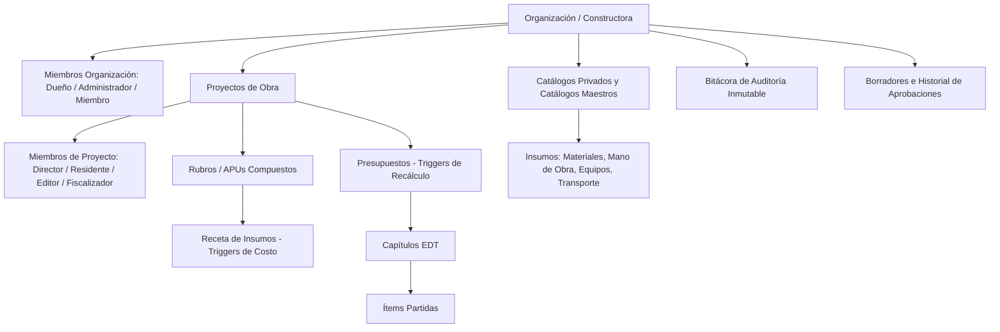

# APUStudio - SaaS Multi-tenant de Análisis de Precios Unitarios (APU)

Plataforma ERP Cloud para constructoras, contratistas y fiscalizadores de obras civiles. Permite la gestión multi-empresa, desglose analítico de costos unitarios (Materiales, Mano de Obra, Equipos y Herramientas, Transporte), elaboración de presupuestos estructurados (EDT/WBS), flujos de aprobación y bitácora de auditoría inmutable.

---

## 🏗️ Arquitectura Técnica

- **Frontend:** React 19 + TypeScript + Vite + TailwindCSS / Vanilla CSS Cohesivo.
- **Backend / Base de Datos:** Supabase PostgreSQL con **Row Level Security (RLS)** estricto y multi-inquilino (*multi-tenant*).
- **Cálculos y Rendimientos:** 100% ejecutados por triggers automáticos en PostgreSQL (`recalcular_rubro`, `recalcular_presupuesto`, etc.), garantizando consistencia matemática y previniendo desincronizaciones en el cliente.
- **Tipado Estricto:** Tipos generados automáticamente desde el esquema de base de datos (`src/types/database.ts`).
- **Despliegue:** Optimizado para **Vercel** como Single Page Application (SPA).

---

## 🚀 Despliegue en Vercel (Paso a Paso)

### 1. Importar el Repositorio en Vercel
1. Conecta tu cuenta de GitHub/GitLab a [Vercel](https://vercel.com/).
2. Haz clic en **Add New...** -> **Project** e importa este repositorio.
3. Vercel detectará automáticamente el framework **Vite**.

### 2. Configurar Variables de Entorno en Vercel
En la sección **Environment Variables** del proyecto en Vercel, agrega las siguientes claves (aplicables a *Production*, *Preview* y *Development*):

| Variable | Descripción | Ejemplo / Valor |
|---|---|---|
| `VITE_SUPABASE_URL` | URL del proyecto Supabase | `https://isgivsefqiaeqsgvcgsm.supabase.co` |
| `VITE_SUPABASE_ANON_KEY` | Clave Pública / Anónima de Supabase con RLS | `eyJhbGciOiJIUzI1NiIsInR...` |
| `VITE_GEMINI_API_KEY` | *(Opcional)* API Key de Google Gemini para asistente IA | `AIzaSy...` |

> ⚠️ **IMPORTANTE DE SEGURIDAD:**  
> NUNCA agregues la clave `service_role` en Vercel ni en ningún archivo del frontend. El cliente web utiliza **exclusivamente** la clave pública/anónima. Todas las restricciones de lectura, escritura y roles se aplican por políticas RLS en la base de datos Supabase.

### 3. Configuración de Construcción (Build Settings)
- **Framework Preset:** `Vite`
- **Build Command:** `npm run build`
- **Output Directory:** `dist`
- **Install Command:** `npm install`

El archivo [`vercel.json`](file:///g:/Mi%20unidad/RESPALDO%20LEGION/APUStudio/2026-06-06%20Google%20AI%20Studio/vercel.json) ya incluye el enrutamiento rewrite SPA (`/(.*) -> /index.html`) y encabezados de seguridad HTTP (`nosniff`, `DENY`, `X-XSS-Protection`).

---

## 🔐 Configuración en Supabase Dashboard

Para que la autenticación, confirmaciones de correo y recuperación de contraseñas funcionen correctamente en producción:

1. Ve a tu panel de Supabase: **Authentication** -> **URL Configuration**.
2. **Site URL:**
   - Configura la URL oficial de producción de Vercel:  
     `https://tu-proyecto.vercel.app`
3. **Redirect URLs:** Agrega los siguientes comodines para soportar tanto desarrollo local como vistas previas de Vercel:
   - `http://localhost:5173/**`
   - `http://localhost:3000/**`
   - `https://tu-proyecto.vercel.app/**`
   - `https://*-tu-usuario.vercel.app/**` (opcional, para Vercel Previews)

---

## 💻 Desarrollo Local

### Requisitos Previos
- [Node.js](https://nodejs.org/) v18 o superior.
- Gestor de paquetes `npm`.

### Instalación y Ejecución
1. Clona el repositorio e ingresa al directorio del proyecto:
   ```bash
   npm install
   ```

2. Configura las variables de entorno locales:
   Crea un archivo `.env.local` en la raíz (puedes guiarte por [`.env.example`](file:///g:/Mi%20unidad/RESPALDO%20LEGION/APUStudio/2026-06-06%20Google%20AI%20Studio/.env.example)):
   ```env
   VITE_SUPABASE_URL=https://tu-proyecto.supabase.co
   VITE_SUPABASE_ANON_KEY=tu-clave-anon
   VITE_GEMINI_API_KEY=tu-gemini-key
   ```

3. Inicia el servidor de desarrollo:
   ```bash
   npm run dev
   ```

4. Para verificar tipos y compilación de producción:
   ```bash
   npm run lint   # Validación de TypeScript sin emitir
   npm run build  # Compilación de producción con Vite
   ```

---

## 🏢 Jerarquía Multi-tenant y Permisos



- **Organización / Constructora (`public.organizaciones`):** Frontera multi-inquilino. Los usuarios pueden pertenecer a múltiples constructoras y cambiar de contexto desde la barra superior.
- **Proyectos (`public.proyectos`):** Obras específicas asignadas a una organización con control granular de roles (`director`, `residente`, `editor_borradores`, `fiscalizador_lectura`).
- **Auditoría (`public.bitacora_auditoria`):** Registro auditable de operaciones de modificación, creación y eliminación en la base de datos.
